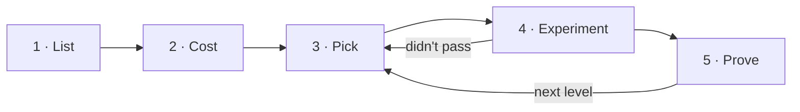

# Onhundred Protocol v1.5

A method for delegating your life and work to AI agents.

Oct 13, 2026 · Ale's own run: Ale Sánchez · Waiting for outside review

## Warning

This protocol hands parts of your life and your work to AI agents. It can strain your relationships, disrupt your company and expose your data. Nobody knows how it ends, because nobody has finished it yet.

**Don't start if you can't stop the moment someone you love asks you to.**

If it works, you get back the hours, the money and the attention
you spend on everything a machine can do for you.

**Delegate agency.**

## How it works

**The goal:** hand to AI agents everything you do that can be handed off safely. Prove each step with numbers.

You split your life (or your job) into a fixed list of things you keep doing, called loops. Start with 10, or list 100 to cover everything. Then you hand them to an AI agent, a few at a time. Each one stays there only if the numbers show it works.

1. **List.** An agent reads your recent history and proposes your loops (10 or 100). Each one comes with a rough guess of what it costs you. You approve the list.
2. **Cost.** Before an agent touches a loop, you write down what it costs you today: time, money and quality. Your estimate is enough to start. If you want proof of time saved, watch it happen 3 times to measure it.
3. **Pick.** You work on 3 loops at a time: one easy, one hard and one fun.
4. **Experiment.** For each loop, you write down a question, your bet and how you'll know the agent did well. Then you try.
5. **Prove.** If it works, it has to keep working for 3 more weeks. Only then does the loop move up a level. Then the same experiment can climb to the next level.

Every 2 weeks you hold a check-in with 3 questions: what worked, what didn't, what's next. You fix the list, refill your picks and record what happened in the log.

**3 rules that never bend:**

- You set the goals before each round of an experiment starts. You never change them after.
- Failures count as much as successes.
- Nobody else is affected by a hand-off unless they know about it and agree.

The rest of this document is the detailed rulebook. Every number in it is in The numbers table (section 16). Words are explained where they first appear and listed under Words at the end.

## 1. Why this exists

It's easy to say AI will change your work. It's harder to say which loops, by how much and at what cost. This method answers that one loop at a time, and keeps the receipts.

**What it sets out to do:**

1. Map what you do, at home and at work, as a fixed list of loops: 10 to start, 100 for everything.
2. Hand to AI agents every loop that can be handed off safely, one level at a time.
3. Measure the time and money each hand-off saves, and what it costs.
4. Write down the steps, costs and failures in enough detail for anyone to follow them.

**Ale's own run:** Ale Sánchez, co-founder and CTO of 4Geeks, runs this method on his own life. He publishes every result at onhundred.com. That way others can see the method work, and fail, on a real case.

This method is written before the results. Its rules don't change to make the results look better.

## 2. Who and what it covers

A life is too big to hand off as one thing. The method cuts it into parts and areas. That way a company can use one part without ever seeing the others.

### 2.1 Parts of life

The method covers your whole life, in 3 **parts**. Each run chooses which parts it turns on.

| Part | What it covers | Who turns it on |
| --- | --- | --- |
| C · Company | Your work: the duties of your role | Personal runs and companies |
| P · Personal | Money, home, income, routines and health, as systems | Personal runs only |
| R · Relationships | The planning around the people who matter to you | Personal runs only |

### 2.2 Runs

A **run** is one person using the method. The loops being handed off are that person's own.

- **Personal run:** you turn on all 3 parts. Ale's own run is a personal run.
- **Company run:** a company runs the method with each employee who takes part. Only the Company part is turned on. The Personal and Relationships parts don't exist for the company. If an employee wants to use them, they belong to the employee alone. The company gets no access.

### 2.3 Never covered, in any run

- Other people's duties. The method hands off what you do, not the people around you.
- Using the method on minors, in any form.
- Medical data or health diagnoses.
- Legal or money decisions that can't be undone, unless you clearly approve them at the time.
- What anyone does who hasn't agreed to take part.

### 2.4 Areas and codes

Each part has **areas**. Every loop has a **code** in the format PART-AREA-NN, for example C-SAL-04 (follow up with leads). The code lets you turn on whole parts and compare the same area across employees. It also lets rules apply by area, without checking loop by loop.

| Part | Base areas (code) |
| --- | --- |
| C · Company | Sales (SAL), Marketing (MKT), Support (SUP), Finance (FIN), Operations (OPS), Product (PRD), People (PPL), Leadership (LDR) |
| P · Personal | Finance (FIN), Home (HOM), Health (HLT), Income (INC), Administration (ADM) |
| R · Relationships | Partner (PAR), Children (KID), Family (FAM), Friends (FRN), Professional network (NET) |

**Rules:**

- Base areas are the same for every run, so results can be compared.
- A company can add areas for its industry (for example, C-EDU for education). It can't rename the base areas.
- A loop belongs to one area. If it fits in 2, you split it into 2 loops.
- A retired code is never used again, so every code keeps one history.
- Consent rules and limits are set by part or by area. Every loop gets them from its code.

## 3. Loops and where they stand

A fixed number of loops (10 or 100), 4 levels, 3 statuses. The number is fixed on purpose: with no fixed size, the list only grows. It starts small on purpose too. 10 loops is a promise most people can keep.

### 3.1 Your list of loops

A **loop** is something you keep doing that ends in a result, clear enough to hand off. Examples: following up after sales calls (C-SAL-04), getting dinner on the table (P-HOM-03), answering the school group chat (R-KID-02). All your loops together are **your list**. It's called a loop because it keeps coming back until someone closes it. An open one keeps taking up space in your head.

- Every run picks its **list size**: 10 (to start) or 100 (everything). No other size is allowed, so results can be compared. Ale's own run uses 100.
- Your list always holds exactly that number. To add a loop, you merge 2 loops or retire a less important one.
- A run can grow from 10 to 100 at any check-in (section 5.4). It never shrinks.
- How loops spread across parts and areas comes from your list. It can change at every check-in.
- A loop keeps its level from one check-in to the next, unless a fix splits, merges or retires it. When you split a loop, the new loops start at still yours. They stay measured if the old measurement still applies. If not, you measure them again.

### 3.2 Levels

Every loop sits on one track of 4 **levels**:

| Level | Who decides | Who acts |
| --- | --- | --- |
| Still yours | You | You |
| Help me | You, with the agent's advice | You |
| Do it, I approve | The agent proposes, you approve | The agent |
| Do it alone | The agent | The agent. You review the results |

Every level above still yours is earned. The loop passed a round and proved it for 3 weeks (section 9).

Separately, every loop's cost today is either **estimated** or **measured**. Estimated means your own account, or the guess on your list. Measured means you watched it 3 times and approved the result (section 6). Measured is a mark on the loop, not a level. Any loop can enter an experiment. A measured one is what turns its time saved into a measured figure. A loop stays measured when it drops.

### 3.3 Status

While you work on a loop, it has one **status** on top of its level. A loop with no status is **waiting**.

| Status | For | What it means |
| --- | --- | --- |
| Measuring | Loops not yet measured | You are recording what it costs today (section 6) |
| Trying | Any loop | A round of an experiment is trying to move it up a level (section 8) |
| Proving | Any loop | A round passed. The loop must keep passing before its level changes (section 9) |

A status never changes a level. Only finishing the 3 weeks of proving, or a drop (section 9.2), does.

## 4. The check-in

2 weeks is long enough to see results and short enough to change course. Every check-in reviews the method itself, not just the results.

Each run moves in blocks of 2 weeks, numbered in order. The log and your list get a new version each time. Between check-ins, the open measurements and experiments run. At the end of each 2 weeks, you hold a **check-in** with 3 questions:

1. **What worked?** Close rounds that reached their deadline and record how they ended.
2. **What didn't?** Record failures and drops, and review the method itself.
3. **What's next?** Fix your list (add, split, merge or retire loops), work out the scores again and fill open picks.

A loop can take several check-ins to move up. The check-in sets the rhythm for review and reporting. It is not the deadline for any one loop.

**How much at once.** Your attention sets the pace, not the number of open threads:

- At most **3 experiments** at once, one for each kind of pick (section 7). An experiment keeps its pick until it ends.
- At most **5 loops with the Measuring status**. Measuring mostly runs on its own, so more of it can run at once.

## 5. Step 1 · Make your list

Calendar, email and documents already describe most of a life. The question for this step: **can an agent read them well enough to map it?**

### 5.1 Steps

1. **History.** An agent reads the last 90 days of your calendar, email and Drive to find things you keep doing. It uses only basic details and summaries (section 10).
2. **Sample week.** For 1 week, you run the computer tracker and the wearable, and add voice notes. This covers what history doesn't show. Required at 100, optional at 10.
3. **Draft.** The agent groups what you do into the chosen number of loops and gives each one its code. It also **estimates** each loop's time, frequency and cost. At 10, it proposes the 10 loops that take the most hours.
4. **Hours check.** At 100, the proposed loops must explain at least 70% of your waking hours in the sample week. You write down the gaps and fill them with voice notes. At 10 there is no hours check. 10 loops are a starting set, not a map.
5. **Review.** You confirm, merge, split or reject each proposed loop. No loop goes on your list without your approval.
6. **Close.** Your list is frozen as version 1. Every loop starts at still yours, and none is measured yet. Making it should take no more than 2 weeks.

### 5.2 Score

You rate every loop from 1 to 5 on 5 things:

| What you rate | Question | Effect |
| --- | --- | --- |
| Time | How many hours a week does it take? | Adds |
| Frequency | How often does it repeat? | Adds |
| Clear rules | How clear is the way it's done? | Adds |
| Digital data | Does the information already live in apps or files? | Adds |
| Error risk | What happens if the agent gets it wrong? | Subtracts |

**Score** = Time + Frequency + Clear rules + Digital data − Error risk. All 5 count the same.

Code works out the score, not you. It uses the estimate until a loop is measured, and the measurement after. Every recorded score says which one it came from.

**Groups:**

- **Automate now:** a score of 13 or more, and error risk of 2 or less.
- **Not yet:** error risk of 4 or more, or a loop already at its limit.
- **Later:** every other loop.

In a company run, the scores added up by area are the first check-up. They show which areas of the company hold the best-scoring loops.

### 5.3 Success and what gets recorded

**Success:** the agent proposed at least 60% of the loops in version 1 without a major fix from you.

**Accuracy over time:** every later fix to a loop your list got wrong is counted at each check-in. A fix means a split, a merge, a retirement or an estimate off by more than half. The count is part of the answer to this step's question.

**Recorded:** your list, which loops the agent got right, which it missed and which it couldn't have known about.

### 5.4 Growing from 10 to 100

At any check-in, a run at 10 can grow to 100. The agent proposes the other 90 loops. The sample week and the hours check run as they would for a new list of 100. The result is frozen as the next version of your list. The first 10 keep their codes, levels, measured marks and history. A run never shrinks from 100 to 10.

## 6. Step 2 · Know what a loop costs

You can't prove an agent saved you time if you never knew how long it took. So you write down what a loop costs today, before any agent touches it. You don't need to measure it to start. You need to measure it to prove time saved.

### 6.1 Estimate (required)

Before a loop's first round starts, you write down its **estimated** cost. That means time each time it happens, how often, money and, where it applies, 1 quality measure. It comes from your own account or the estimate on your list. You put it on the experiment card before round 1, so nobody can adjust it after the results. An estimate is enough to run an experiment. Every figure built on it is labeled estimated.

### 6.2 Measure (optional)

Measuring turns the estimate into a **measured** cost. You measure the loops you want proof for, usually before an experiment starts. Once an agent does the loop, you can't measure doing it by hand anymore. You can also measure from records (calendar, email, the computer tracker) when the history shows each time it happened. A loop is measured only while it has the Measuring status.

**How long.** You measure until you've watched the loop happen 3 times. Why 3: once is a story, twice can be chance, 3 times is a pattern worth comparing against. A daily loop takes days to measure. A monthly loop takes months. Slow loops measure in the background while faster ones move ahead.

**Time limit.** Say a loop hasn't happened 3 times in 90 days. Its cost then comes from the times you did see, marked as less certain. A loop not seen even once in 90 days is reviewed at the next check-in. It may not repeat at all, so you can retire it or merge it.

**What is recorded:**

- **Time:** how long it takes each time.
- **Frequency:** how often it actually happens.
- **Money:** anything you spend doing it.
- **Quality:** where it applies, a measure the experiment can compare against later. Examples: reply rate for lead follow-ups, zero late payments for bills.

**Scope.** Measure only what the loop needs. Measuring one loop is no reason to record anything beyond that loop.

**Approval.** You approve the measured cost, and the loop is marked measured. Its score is worked out again with real data. If an experiment is already running, the measured cost replaces the estimate for time saved. Goals already written down don't change.

## 7. Step 3 · Pick what to work on

One loop likely to win, one likely to lose, and one picked for fun. The method works all 3 at once and states the rule ahead of time. That way the choice is part of the method, not a hidden bias.

You have 3 **picks** for experiments, each of a different kind:

| Pick | Which loop goes in | Why |
| --- | --- | --- |
| Easy | The waiting loop with the highest score in the Automate now group | An early, likely win that keeps the pace |
| Hard | The waiting loop with the highest Time rating, outside the Not yet group. Its Clear rules or Digital data must be 2 or less | A valuable loop that needs research, longer measuring or blockers removed |
| Fun | Any waiting loop outside the Not yet group that you enjoy. It can be something silly you'd love to automate (getting dinner on the table counts), or something you love doing | Keeps you interested |

Any loop can fill a pick. If it isn't measured, you write down its estimated cost before round 1 (section 6.1).

**Rules:**

- A pick is filled as soon as it opens: at the check-in, or when its experiment ends. A pick never waits for the next check-in.
- Code fills your easy and hard picks from the scores. That way you can't quietly pick only the loops you already like. If 2 loops tie, the one that comes first by code wins.
- The fun pick always records why you chose it.
- If no loop fits a pick, it stays empty, and that is recorded.

**Expected curve.** Before your first 2 weeks start, you sketch how you expect Handed off to change over time. Easy loops go first, so you expect it to rise fast and then slow down. Results are always reported by kind of pick. That way the early rise isn't mistaken for the long-term trend.

## 8. Step 4 · Run an experiment

An **experiment** is a question nobody can answer yet and a bet that can lose. It gets up to 3 **rounds** to find out. Everything is written down before it starts. That way nobody, not even you, can move the goalposts. Experiments are what people follow. How you word and publish them matters as much as how you run them.

### 8.1 The experiment card

You add the card to the log before round 1 starts. After that it only grows: rounds are added, nothing is rewritten.

| Field | What goes in it |
| --- | --- |
| Code | EXP-NN |
| Question | What the experiment answers, in one sentence anyone understands. Example: "Can an agent sell on a voice call, even when the buyer knows it's an agent?" |
| Your bet | What you think will happen, written as If, then, because. See the example below |
| Loops | Which loops it tries to move |
| Pick | Easy, hard or fun. For fun, why you chose it |
| Start and target level | The loops' level today, and the highest level the experiment aims for, within the limit |
| What it costs today | Each loop's cost: measured, with how sure you are, or estimated |
| People involved | Who, and proof that they agreed |

**Example bet:**

- **If** an AI voice agent, introduced as an AI, makes first sales calls to leads who agreed to it,
- **then** it will close less than half as many sales as I do,
- **because** buyers don't connect with an agent.

**A good question** is one sentence and can be answered. It is about something people care about, with no jargon.

**A good bet** names the approach, the result you expect and the reason. That way the result can prove it wrong.

### 8.2 Rounds

An experiment climbs one level per round, with up to 3 rounds. Round 1 aims for help me. Round 2 aims for do it, I approve. Round 3 aims for do it alone. You write each round down before it starts. Once it starts, you never change it.

| Field | What goes in it |
| --- | --- |
| Round | 1, 2 or 3, and the level it aims for |
| Approach | What the agent will do, with which tools, and how it fits into your work |
| Why this approach | Why it should work, and what earlier rounds taught |
| Goals | What the round must do to pass, with a number to reach where it applies |
| Stop if | What ends the round at once |
| Dates | Start date and deadline |
| Expected cost | Tools and estimated AI cost |
| Risks | What could go wrong and how you would notice |

You can write a round down when the experiment starts or after the last round ends. That way each round can use what the last one taught. The approach never changes in the middle of a round. Instead, you stop the round and write down a new try of the same round.

### 8.3 Ending a round

Every round ends one of 3 ways:

- **Passed:** it met its goals. The loop gets the Proving status (section 9).
- **Didn't pass:** the deadline came and it hadn't passed. You write down a new try of the round, or end the experiment.
- **Stopped:** the round was stopped early, with the reason. Same options as didn't pass.

Every result is recorded with the actual cost and what you learned.

### 8.4 Ending the experiment

An experiment ends when it reaches its target level, or when you decide to stop climbing. It also ends when the loop drops back to still yours (section 9.2). At the end, you record the final level reached. You also record whether your bet was right, wrong or not clear. A wrong bet is a result, not a failure.

## 9. Step 5 · Prove it holds

Passing once proves an agent can do it. Passing for 3 weeks proves it does. A running round **never** changes a loop's level. Only finishing the 3 weeks of proving does.

### 9.1 Moving up

A loop moves up one level when:

1. Its current round ended as passed.
2. It kept passing that round's goals for 3 weeks in a row while proving. That's long enough to include a bad week, and short enough to keep moving.
3. You didn't have to step in to rescue it in those weeks, beyond what its level expects.
4. Its AI cost is less than the time or money it saves is worth. If not, you write down why it should still move up.
5. The new level is not above the loop's limit.

If any of these fails, the Proving status comes off and the level stays where it was. Once the loop moves up, the experiment's next round can start.

### 9.2 Moving down

| Cause | Result |
| --- | --- |
| Fails its goals for 5 days in a row | Drops 1 level |
| Causes real harm to a person, to your money or to the company | Drops to still yours at once |
| Loses the consent of anyone involved | Drops to still yours at once |

A drop never erases what the loop costs today. A measured loop stays measured. It can enter a new experiment without being measured again. Every drop is recorded with its cause. A loop's status always shows its most recent round. That way a later failure is never hidden behind an earlier success.

### 9.3 Limits

A **limit** is the highest level allowed in an area, even if the loop could go higher.

| Code | Limit |
| --- | --- |
| R-KID · Children | Help me |
| R-PAR · Partner | Do it, I approve, only with their consent and a stop button |
| P-HLT · Health | Help me |
| P-FIN · Decisions over $500 | Do it, I approve |
| C-PPL · Decisions about people (hiring, reviewing, firing) | Help me |

Limits are enforced in code. No loop can be recorded above its limit. In the Company part, a company can set stricter limits by area. It can never set looser ones than these.

## 10. What gets recorded, and what never does

The method needs data about your life. It never needs anyone else's. Every rule below follows from that.

**Sources:**

| Source | What it records | Rule |
| --- | --- | --- |
| Computer tracker on your own machine (for example, Screenpipe) | Apps, documents, sites and meetings | Screen only, processed on your machine |
| Wearable device (for example, Omi or Plaud NotePin) | What you do away from the desk | Off at home. If always on, muted by location |
| Calendar, email and Drive, including the last 90 days | Meetings and things you keep doing | Basic details and summaries only. Nothing other people wrote |
| Your voice notes | What leaves no digital trace | Your own voice only |

**Recording rules:**

- You may record yourself. You don't record other people without their consent. Many places, including Florida, require everyone's consent to record a talk.
- Work calls and meetings are recorded only with the usual recording notice at the start.
- The home is not recorded.

**Keeping and deleting:**

- The agent pulls out what you did, not what others said.
- Raw audio is deleted on its own after it is summarized, within 7 days at most. Code enforces this rule, not a person.
- Summaries are kept while the run lasts. Anyone mentioned in one can ask to have it deleted.

**Security:** raw data and summaries live on storage you control. It is encrypted, and nobody else can reach it. An outside AI provider gets only what a loop needs. The experiment card says so.

## 11. Your numbers

3 numbers, all worked out in code, none typed by hand. How much is handed off, how much time it saved and what it cost.

| Number | How it is worked out |
| --- | --- |
| Handed off (the main number) | Points out of your list size. Each loop at do it, I approve or do it alone counts 1. Help me counts 0.5. Still yours counts 0. Always written with its half points and its size (3.5 of 10, 23.5 of 100), never rounded |
| Time saved | Hours a week you no longer spend, against what each loop cost before. Shown in 2 parts: measured (measured loops) and estimated (the rest). Never added into one figure without its label |
| Money saved (after AI costs) | Money saved and earned by handed-off loops, minus AI and tool costs |

Help me counts half. It is real progress. Without it, loops whose area stops them at help me would never count.

When runs of different sizes are compared, Handed off is also shown as a percent of the list. 3.5 of 10 is 35%.

By part or area, each number is worked out the same way over that part's or area's loops. All 3 are also reported by kind of pick. In a company run, they are reported by area in the **team grid**. The team grid adds up all employees' loops by area. It never shows one employee.

**Rules that keep the numbers honest:**

- Code works out every number from its sources: your list, agent logs, AI bills, receipts and documents. Nobody types one in by hand.
- Every number records its formula and the date it was last updated.
- The code that works out the numbers is open, and so is the table it reads (section 16). Both live with the method at delegate.onhundred.com.
- Estimated and measured figures are always labeled.
- Savings need a document that can be checked (policy, contract, statement), with private data hidden.
- Money earned counts only if it comes straight from something you handed off.
- If a math error is found, it is fixed and the fix is recorded. Old values stay in the history.

## 12. Who has to agree

**The main rule:** the method hands off what you do. Nobody else is affected by a hand-off unless they know about it and agree.

| Person | Rule |
| --- | --- |
| Partner | Knows the method is running. Approves anything published about them. Can stop any loop that involves them, at any time. May not know which message had AI help, but always knows the method is running |
| Children | The method is never used on them. Only your own planning for time with them is automated. They never appear in any record with their face or details that identify them |
| Family and friends | Told before they appear in anything published. They can ask not to appear |
| Employees and team | Taking part is a free choice and doesn't affect their job. Consent is never a condition |
| Students, leads and clients | Calls and messages with them are recorded only with the usual notice. Nothing that identifies them is published |
| Companies in published case studies | Sign a publishing agreement before starting |

**Loop names** never include a person's name or any detail that identifies them. Loops in R-PAR are published only with your partner's approval.

**Stop button:** anyone involved can ask to stop whatever involves them. The loop drops to still yours at once. They don't have to give a reason.

**Health:** you share systems (routines, reminders), never medical data.

### 12.1 Rules for company runs

Every loop with a C code follows these rules when a company runs the method with its employees. The company signs them before starting.

1. **One purpose only.** Lists, scores and results are never used to judge performance, decide layoffs or set pay.
2. **A promise about saved time.** Before starting, the company writes down what happens to the hours saved. Examples: new projects, training, less overtime or another use. It tells every employee who takes part.
3. **Taking part is a free choice.** No employee has to take part, and saying no has no effect on them. Where workers have a union or works council, the company agrees the terms with it.
4. **Data belongs to the employee.** Raw data belongs to the employee. The company sees the team grid by area and the experiment results. It never sees one person's activity minute by minute.
5. **At least 5 people.** The team grid shows an area only when at least 5 employees in it take part. That way nobody can be identified.
6. **Personal and Relationships stay closed.** The company can't see any employee's Personal or Relationships parts. It can't even know whether they use them.
7. **Own pace.** Each employee has their own picks and limits on how much runs at once. The company can't choose an employee's fun pick.
8. **Local law.** Before starting, the company reviews the legal notes for each region where employees take part. Examples: monitoring notices in the US, GDPR and works councils in Europe, local rules in Latin America.

**Roles:**

| Role | What they do |
| --- | --- |
| Executive sponsor | Signs the rules and the promise about saved time |
| Coordinator | Runs the check-ins, keeps the log and reports results inside the company |
| Each employee | Runs their own list, approves it, takes part in experiments and can leave at any time |
| Reviewer | Someone outside the employees' chain of command who checks that these rules are followed |

## 13. Sharing results

Every run keeps a **log**: its list, experiments, results and changes. Who sees the log depends on who is running it.

| Run | Who sees the log |
| --- | --- |
| Ale's own run | Everyone. It is published at onhundred.com, with agents, prompts and setups at delegate.onhundred.com |
| Personal run | You. Publishing it is your choice |
| Company run | The employee, and the coordinator by area, under section 12.1 |

**What the log holds:**

- The grid (the picture of all the loops on your list), updated from its sources.
- The expected curve, written before your first 2 weeks start.
- Each experiment: its card before round 1, each round before it starts, and every result.
- One entry per check-in: what worked, what didn't and what's next. It also lists what changed in those 2 weeks. That means loops added, retired, split and merged, status and level changes, and the list accuracy count.
- The agents, prompts and setups used.

**Publishing an experiment.** Each experiment gets one page. It starts with the question and your bet. Then come the rounds and where each one stands. Then the results against the goals, and what surprised you. Wrong bets and stopped rounds get the same space as the rest.

**Rules for every log, private or public:**

- Failures count as much as successes.
- No figure is recorded unless it can be checked.
- Details about other people are removed before anything is published.

**Ale's own run only:** a time saved figure is published as measured only when its loop is measured. Otherwise it is published as estimated. 4Geeks figures are published only with the business partners' agreement (section 17). Case studies with companies follow the agreement signed with each one. That includes how a failed result is published.

## 14. When to stop

No hours saved are worth a relationship, a company or a person's health. If any of these happens, you pause the whole run, not just one experiment:

1. **Relationships:** your partner or a close family member asks you to stop. Or you see the method is hurting a relationship.
2. **Health:** for 2 weeks in a row, you work more hours than your usual week. Your usual week is the average from the 90 days of history used to make your list. Or a health expert tells you to pause.
3. **Company:** an automation causes real harm to the company or its clients.
4. **Legal:** any fair doubt about whether a recording or a post is legal. You stay paused until a lawyer settles it.
5. **Data:** a leak, or someone getting into the run's data without permission.

**When paused:** record the pause and its reason in the log, with as much detail as the situation allows. The run starts again only once the cause is fixed and the change is written down.

## 15. Keeping it honest

Ale runs his own run in public, and he also sells AI training. This section keeps that interest away from the results. It also says how the method itself may change.

### 15.1 Conflict of interest in Ale's own run

Ale is a co-founder and shareholder of 4Geeks. 4Geeks offers AI training and automation services to companies. Onhundred also helps people find 4Geeks. It can bring 4Geeks money through courses, company reviews and case studies.

To keep that interest out of the results:

- Goals are set before each round and never changed after.
- The rule for picking loops is written in this method. Every fun pick is published with its reason.
- Failures are published with the same weight as successes, even when they don't help 4Geeks.
- Tools are chosen for results, not business ties. Any sponsor deal or agreement with a tool is made public.
- Onhundred's published content makes no sales offers. The tie to 4Geeks is made public on the site.

### 15.2 Changes to the method

- The method has version numbers (v1.0, v1.1, v2.0), and every version stays published.
- Every change goes in a public What changed list, with its date, what changed and why.
- Changes apply from the next check-in. The goals of a round that has started never change.
- A change that loosens a rule about ethics, consent or limits needs an outside review first.
- At each check-in, you review the method for needed changes. That includes the score weights and The numbers table.

## 16. The numbers

Every number in the method lives here. The code that works out your numbers reads this table, published as a settings file. The last column says whether a run (a person or a company) can change a value.

| Setting | Value | What it controls | Section | Can a run change it? |
| --- | --- | --- | --- | --- |
| List size | 10 or 100 | Loops on your list | 3.1, 5 | Yes, 10 or 100 only. It grows, never shrinks |
| Check-in timing | 2 weeks | How often you hold a check-in | 4 | Yes |
| Experiment picks | 3 (easy, hard, fun) | Experiments running at once | 4, 7 | The number, yes. The 3 kinds, no |
| Measuring at once | 5 | Loops being measured at once | 4, 6 | Yes |
| History read | 90 days | Records read to make your list | 5 | Yes |
| Sample week | 1 week, required at 100, optional at 10 | Live recording to fill gaps in history | 5 | Longer only |
| Hours explained | 70% of waking hours, at 100 only | The least your list must explain | 5 | Higher only |
| List success | 60% of loops | Agent's loops kept without a major fix | 5 | No, so results can be compared |
| Score groups | Automate now: score 13+ and risk 2 or less. Not yet: risk 4+ | How loops are grouped | 5.2 | No, so results can be compared |
| Score weights | All equal | How much each rating counts | 5.2 | Reviewed at each check-in |
| Hard pick rule | Clear rules or Digital data 2 or less | Which loops count as hard | 7 | No, so results can be compared |
| Times to measure | 3 | Times you watch a loop to measure it | 6.2 | Higher only |
| Measuring time limit | 90 days | Longest a loop can be measured | 6.2 | Yes |
| Prove it | 3 weeks in a row | How long a passed round must keep passing before the loop moves up | 9.1 | Longer only |
| Help me weight | 0.5 | What a loop at help me counts toward Handed off | 11 | No, so results can be compared |
| Failure days | 5 days in a row | Failures before a loop drops a level | 9.2 | Fewer only |
| Money limit | $500 | Decisions above it can't reach do it alone | 9.3 | Lower only. Personal runs only |
| Raw audio deletion | 7 days | Longest raw audio can exist | 10 | Shorter only |
| Smallest area in the team grid | 5 employees per area | Fewest people an area needs before the team grid shows it | 12.1 | Higher only |
| Health stop | 2 weeks in a row | Weeks of extra work hours before you pause | 14 | Fewer only |

Limits by area (section 9.3) follow the same logic. A run can only make them stricter.

## 17. Still to decide

These items aren't decided by one person alone. Until each one is settled, the rule in the last column applies.

| Item | What's needed | Until then |
| --- | --- | --- |
| Outside review | Someone with research experience reviews this method | The method is published as waiting for outside review |
| Legal review | A lawyer reviews the rules on recording and publishing | Outside recorded work meetings, only your own voice and screen are recorded |
| Legal notes by region | Notes for the US, Latin America and Europe | No company run starts in a region without its notes |
| Company figures | Agreement with the 4Geeks business partners on which figures Ale's own run shares | No 4Geeks figure is published |
| Final base areas | Confirm the base area list after the first list is made | The areas in section 2.4 apply |

## Words

| Word | Meaning |
| --- | --- |
| Ale's own run | Ale Sánchez's public run of the method, published at onhundred.com |
| Area | A group of loops within a part of life, such as Sales within Company |
| Check-in | The review every 2 weeks: what worked, what didn't, what's next. Check-ins are numbered from 1 |
| Code | A loop's ID, in the format PART-AREA-NN |
| Estimate | A loop's rough time, frequency and cost, from existing records or your own account |
| Experiment | Handing one loop to an AI agent to see if it works. It has a question, your bet and up to 3 rounds (EXP-01 onward) |
| Goals | What a round must do to pass, written before it starts |
| Grid | The picture of all the loops on your list |
| Group | Automate now, Later or Not yet, set by a loop's score |
| Handed off | The main number. Each loop at do it, I approve or do it alone counts 1, and help me counts 0.5. Written as "3.5 of 10" |
| Level | Where a loop stands: still yours, help me, do it, I approve, or do it alone |
| Limit | The highest level a loop can reach, set by area |
| List size | The fixed number of loops on your list: 10 (to start) or 100 (everything) |
| Log | A run's record: your list, what you wrote down before each start, results and changes |
| Loop | Something you keep doing that ends in a result, clear enough to hand off. It keeps coming back until someone closes it |
| Measured | A loop whose cost you watched 3 times and approved. A mark on the loop, not a level |
| Part of life | Company (C), Personal (P) or Relationships (R) |
| Pick | One of the 3 places for a running experiment: easy, hard or fun |
| Prove it for 3 weeks | After a round passes, the loop must keep passing its goals for 3 weeks before its level changes |
| Round | One level of an experiment, with its own approach and goals |
| Run | One person using the method, alone or as part of a company |
| Score | The number that says which loops to try first |
| Status | What a loop is doing right now: Measuring, Trying or Proving |
| Team grid | All employees' loops added up by area. Only in company runs |
| Times | Each time a loop happens. You measure a loop over 3 times |
| Waiting | A loop with no status |
| What it costs today | A loop's time, frequency, money and quality before AI touches it. Estimated by you, or measured over 3 times |
| Your bet | What you think an experiment will show, written as If, then, because |
| Your list | All your loops, with a new version every 2 weeks |

## What changed

**v1.5 · Oct 13, 2026.** Plain English. Same rules, simpler words. No rule, number or step changed. The main renames:

- Inventory is now your list. Owner is now you. Application is now run: personal run, company run and Ale's own run.
- Branch is now part of life (Company, Personal, Relationships). Baseline is now what it costs today. Timed is now measured, and occurrence is now times.
- Triage is now score. Slot is now pick: the easy, hard and fun pick. Stage is now round. Success tests and evals are now goals. Stop early if is now stop if.
- Hypothesis is now your bet. Confirmed, refuted and unclear are now right, wrong and not clear.
- Holding is now proving: prove it for 3 weeks. Flags are now statuses: Measuring, Trying and Proving. Idle is now waiting.
- Achieved, not achieved and terminated are now passed, didn't pass and stopped.
- Levels are now Still yours, Help me, Do it, I approve and Do it alone. Ceiling is now limit.
- Cycle is now the 2 weeks between check-ins. Metrics are now your numbers: Handed off, Time saved and Money saved (after AI costs). Aggregate grid is now team grid.
- Section titles renamed. Parameters is now The numbers, Open items is now Still to decide, Glossary is now Words and Changelog is now What changed.
- The code format BRANCH-AREA-NN is now PART-AREA-NN. The five steps are now List, Cost, Pick, Experiment and Prove.
- The levels table drops the "In plain words" column, since the level names are now plain. The example bet is shown as If, then and because lines.

**v1.4 · Oct 13, 2026.** Measuring is optional:

- An experiment can start from an estimated baseline. The owner writes down the loop's cost from their own account before stage 1, and it is recorded on the experiment card.
- Measuring over 3 occurrences is now optional. It turns the estimate into a timed baseline, the proof needed for a measured time freed figure.
- Step 2 is renamed "Know what a loop costs", with 6.1 Estimate (required) and 6.2 Measure (optional).
- Any loop can fill a slot. Experimenting and Holding apply to any loop.
- Time freed is reported in two parts, measured and estimated. The reference application publishes time freed as measured only for timed loops.

**v1.3 · Oct 13, 2026.** A smaller start:

- The inventory size is now 10 or 100. Starters commit to 10 loops, and the reference application stays at 100. The fixed-size rule applies to whichever size was chosen.
- At 10, the agent proposes the 10 loops that take the most hours, the sample week is optional and there is no coverage check.
- Added section 5.4: an application can grow from 10 to 100 at any check-in, keeping each loop's history, and never shrinks.
- Delegated is written with its size (3.5 of 10) and reported as a percentage when sizes are compared.
- Added Inventory size to the Parameters table and the glossary.

**v1.2 · Oct 13, 2026.** Simplified levels and the cycle, after feedback that the method was hard to follow:

- Replaced unmapped and mapped with one starting level, still yours, and a separate timed mark. Neither old level said anything about the agent, so the track is now four levels, three of them real progress. Only timed loops can enter an experiment, and drops go to still yours while keeping the baseline. The Delegated metric is unchanged.
- Added a plain-words column to the levels table.
- Replaced Map, Delegate and Review with one check-in at the end of each cycle, with three questions: what worked, what didn't, what's next.
- Removed the weekly log entry. The check-in entry is the only update.
- Slots are refilled as soon as an experiment concludes, instead of waiting for the next check-in.

**v1.1 · Oct 12, 2026.** Editorial change, no rule changed:

- Renamed the example loop P-HOM-03 from "deciding what's for dinner" to "getting dinner on the table" in sections 3.1 and 7. A decision is a step, not a result, so examples now name what the loop produces, following LOOPS.md.

**v1.0 · Oct 9, 2026.** First published version. Changes from the Oct 5 draft:

- Rewrote every section opener to say why the section exists, added a one-line reason next to the key numbers (100 loops, 3 occurrences, 3-week hold), and renamed sections 10 and 14 in plain words, following VOICE.md.
- Reframed the protocol as a method for delegating life and work to AI agents. Ale Sánchez's public project at onhundred.com is now its reference application.
- Renamed the subject to the owner and parts to loops, and replaced public publication with a log: public for the reference application, private or internal for any other.
- Made delegated loops (assisted counts half), time freed and net savings the metrics.
- Added "How it works", a one-page summary of the five steps and the three rules that never bend.
- Reorganized the rulebook around the five steps: inventory, measure, choose, experiment, hold.
- Replaced the upfront Phase 0 with a fast inventory built from existing history plus one sample week, and a baseline measured per loop, by occurrences (3) with a 90-day cap.
- Merged the separate stage track into the levels: one track of five levels, plus three temporary flags (Measuring, Experimenting, Holding).
- Added fixed two-week cycles and work-in-progress limits (3 experiment slots, 5 measuring slots).
- Added typed slots (easy, hard, fun), the selection rules and the expected curve.
- Gave experiments a question, a hypothesis and up to three stages, one per level, so one experiment tells the whole story of a loop.
- Made explicit that a running stage never changes a level, added the holding period and the three close outcomes, and made a loop's status follow its most recent experiment.
- Defined triage group thresholds and labeled scores as estimated or measured.
- Collected every number in a Parameters table, published as the configuration the metrics code reads, with what each application may change.
- Codes are never reused, ceilings are enforced in code, and loop names carry no identifying detail.
- Moved definitions to a glossary at the end and non-numeric pending items to Open items, each with the rule that applies until it is resolved.